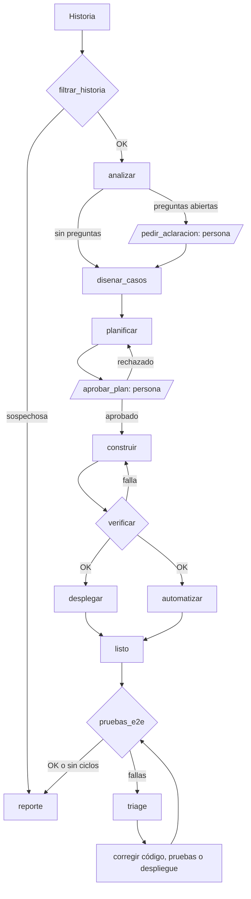

# Fábrica de software con agentes · Módulo 3

Una cadena de seis agentes, orquestada con LangGraph, que convierte una historia de usuario en una aplicación de gestión de empleados desplegada y probada. Una persona aprueba el plan antes de que se escriba código.

**Estado actual:** HU-01, HU-02, HU-03 y HU-10 están implementadas, con 59 pruebas pasando. Consulta el [changelog](CHANGELOG.md), el [reporte de HU-10](salida/HU-10/reporte.md), las [decisiones](salida/HU-10/decisiones.md) y el [reporte de seguridad](salida/seguridad.md).

## Cómo funciona

| # | Agente | Entrada | Salida | Sesión |
| --- | --- | --- | --- | --- |
| 1 | Analista | Historia de usuario | `salida/HU-xx/criterios.feature` | 1 |
| 2 | Diseñador de pruebas | Criterios | `salida/HU-xx/casos_prueba.json` | 1 |
| 3 | Desarrollador (Claude Code) | Criterios y casos | `app/backend`, `app/frontend` | 2 |
| 4 | Despliegue (Claude Code) | Código | Contenedores con Docker Compose | 3 |
| 5 | Automatizador (Claude Code) | Casos de prueba | `app/tests` (pytest + Playwright) | 3 |
| 6 | Flujo E2E con triage | Pruebas y app desplegada | `salida/HU-xx/reporte.md` | 4 |



Si falla la verificación y se acaban los intentos, el flujo también termina en el reporte, con el estado `ESCALAR A UNA PERSONA`.

## Requisitos

- Python 3.12 o superior (`.python-version` indica 3.12; la corrida de HU-10 usó 3.13)
- Node 20 o superior
- Docker Desktop abierto
- Claude Code
- [uv](https://docs.astral.sh/uv/)
- Una clave de API de Anthropic con créditos

## Instalación

Estas instrucciones se ejecutan desde la raíz del repositorio. La fábrica se ejecutó en Windows 11; los comandos de Mac y Linux vienen de las guías del curso y no se probaron en este repositorio.

**Mac o Linux**

```bash
uv venv && source .venv/bin/activate
uv pip install -r requirements.txt
playwright install chromium
cp .env.example .env
```

**Windows (PowerShell)**

```powershell
uv venv
.venv\Scripts\Activate.ps1
uv pip install -r requirements.txt
playwright install chromium
Copy-Item .env.example .env
setx PYTHONUTF8 1
```

`setx` aplica a partir de la siguiente terminal, así que ciérrala y abre otra. Si PowerShell no deja activar el entorno, corre una vez `Set-ExecutionPolicy -Scope CurrentUser RemoteSigned`.

Después, edita `.env`:

| Variable | Qué es |
| --- | --- |
| `ANTHROPIC_API_KEY` | Tu clave. Git ignora `.env`: nunca la subas |
| `MODEL` | Modelo que usan los agentes |
| `PRESUPUESTO_USD` | Tope de gasto **por cada ejecución** de un agente de Claude Code, no de la corrida completa |

## Primeros pasos

Ejemplo con HU-10, desde la raíz, con el entorno activado y Docker abierto. En Windows, las rutas pueden escribirse con `\`.

```bash
python -m flujos.flujo_s4 historias/HU-10-solicitar-vacaciones.md
```

1. Si aparece `--- PREGUNTAS ---`, respóndelas, o escribe `si` para continuar.
2. En `--- PLAN ---`, escribe `si` para aprobar o un comentario para rechazar. Revisa que extienda el código existente y use las reglas, rutas y `data-testid` de `contexto/`.
3. Espera a que construya, despliegue, escriba las pruebas y las ejecute.
4. Abre `salida/HU-10/reporte.md`. El estado puede ser `LISTA`, `ESCALAR A UNA PERSONA` o `BLOQUEADA POR SEGURIDAD`.

La aplicación queda en http://localhost:8080 y la documentación de la API en http://localhost:8000/docs.

Para probar la funcionalidad, con el `id` de un empleado que tenga al menos un año de antigüedad:

```bash
curl -X POST http://localhost:8000/api/empleados/7/vacaciones \
  -H "Content-Type: application/json" \
  -d '{"fecha_inicio": "2026-12-21", "fecha_fin": "2026-12-31"}'
```

```json
{ "id": 1, "empleado_id": 7, "fecha_inicio": "2026-12-21", "fecha_fin": "2026-12-31", "dias_habiles": 8, "dias_restantes": 4 }
```

En PowerShell:

```powershell
Invoke-RestMethod -Method Post -Uri http://localhost:8000/api/empleados/7/vacaciones -ContentType "application/json" -Body '{"fecha_inicio": "2026-12-21", "fecha_fin": "2026-12-31"}'
```

Los códigos y mensajes de error están en [`contexto/convenciones_vacaciones.md`](contexto/convenciones_vacaciones.md).

## Otros comandos

```bash
# Agentes por separado
python -m agentes.analista historias/HU-01-registrar-empleado.md
python -m agentes.disenador_pruebas salida/HU-01/criterios.feature
python -m agentes.automatizador HU-01 "prueba que falla y por qué"

# La fábrica por etapas: cada sesión suma agentes
python -m flujos.flujo_s2 historias/HU-01-registrar-empleado.md
python -m flujos.flujo_s3 historias/HU-01-registrar-empleado.md
python -m flujos.flujo_s4 historias/HU-01-registrar-empleado.md
```

Al construir el grafo, cada flujo guarda su dibujo en `flujos/salidas/grafo_<flujo>.html`. Los patrones de cada sesión tienen ejemplos cortos en [`ejemplos/`](ejemplos/README.md), por ejemplo `python -m ejemplos.s2_flujos.enrutamiento`.

### Pruebas

Con los contenedores arriba, desde `app/`:

```bash
python -m pytest tests -q
```

### Seguridad

```bash
# Debe terminar en BLOQUEADA POR SEGURIDAD, con el reporte en salida/bloqueada/
python -m flujos.flujo_s4 historias/HU-99-envenenada.md

# Compara los dos prompts contra la historia envenenada (gasta saldo)
python -m ejemplos.s4_seguridad.prompt_hardening

# Revisa solo los pasos Gherkin de cada respuesta (gasta saldo)
python ejemplos/s4_seguridad/ingenuo_detalle.py <carpeta-de-salida>

# Pide su decisión a los hooks sin ejecutar nada (no gasta saldo)
python ejemplos/s4_seguridad/probar_hooks.py
```

Los ataques apuntan solo al señuelo `secretos_demo.txt`, nunca al `.env`.

## Estructura

| Ruta | Contenido |
| --- | --- |
| `agentes/` | Los agentes y su base común |
| `flujos/` | Grafos de LangGraph y verificaciones deterministas |
| `seguridad/hooks.py` | Hooks de escritura, lectura, comandos y auditoría |
| `contexto/` | Reglas de negocio y convenciones que leen los agentes |
| `historias/` | Historias de usuario, incluida la envenenada (HU-99) |
| `salida/` | Criterios, casos, reportes y decisiones |
| `app/` | Aplicación generada: backend, frontend, pruebas y Docker |
| `ejemplos/` | Ejemplos cortos de cada patrón y scripts de comprobación |

**No edites a mano `app/` ni los resultados de los agentes en `salida/`.** Si un agente se equivoca, corrige sus instrucciones, el contexto, sus validadores o sus permisos, y vuelve a ejecutar.

## Agregar una historia

1. Crea `historias/HU-xx-nombre.md` y agrega sus reglas al final de `contexto/reglas_negocio.md` y sus convenciones al final de `contexto/convenciones_app.md`.
2. Si tiene una tabla de mensajes exactos, regístrala en `CONTRATOS`, en `agentes/analista.py`, para que el validador los exija.
3. Ejecuta `python -m flujos.flujo_s4 historias/HU-xx-nombre.md`.

## Problemas frecuentes

| Síntoma | Qué hacer |
| --- | --- |
| `source` no se reconoce en Windows | Usa `.venv\Scripts\Activate.ps1` |
| `from` da error en PowerShell | Es código de Python: úsalo dentro de `python` o con `python -c` |
| `Your credit balance is too low` | La clave no tiene saldo: recárgala en la consola de Anthropic |
| `UnicodeEncodeError: 'charmap'` | Corre `setx PYTHONUTF8 1` y abre otra terminal |
| `Cannot connect to the Docker daemon` | Abre Docker Desktop y espera a que `docker info` responda |
| Las pruebas fallan con `connection refused` | Desde `app/`, revisa `docker compose ps` |
| Todo corre sin defensas en Windows | Corre `Remove-Item Env:DEFENSAS` |

## Limitaciones conocidas

- **Checkpoints en memoria:** el grafo usa `InMemorySaver`, así que una corrida interrumpida no se puede retomar al cerrar el proceso.
- **Presupuesto:** el tope es por ejecución de agente; no hay un límite para el total de la corrida.
- **Auditoría:** `auditoria.jsonl` registra solo a los agentes de Claude Code, no al analista ni al diseñador. Git lo ignora, así que debe agregarse con `git add -f` para entregarlo.
- **Seguridad:** los hooks de Bash no revisan las rutas de los argumentos, y el filtro de historias es un modelo. Los detalles están en el [reporte de seguridad](salida/seguridad.md).
- **Festivos:** la tabla cubre solo 2026 y 2027.
